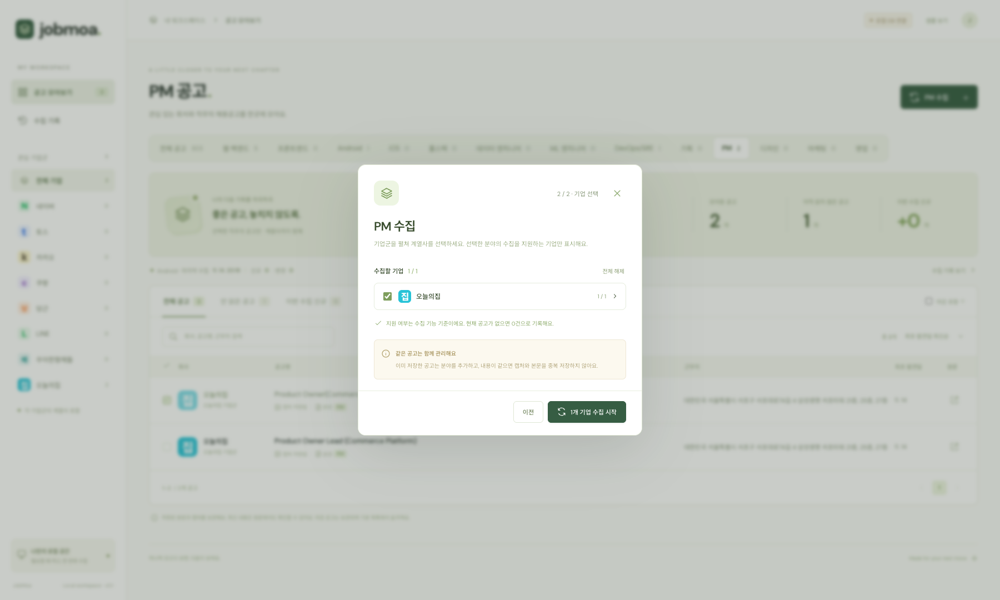
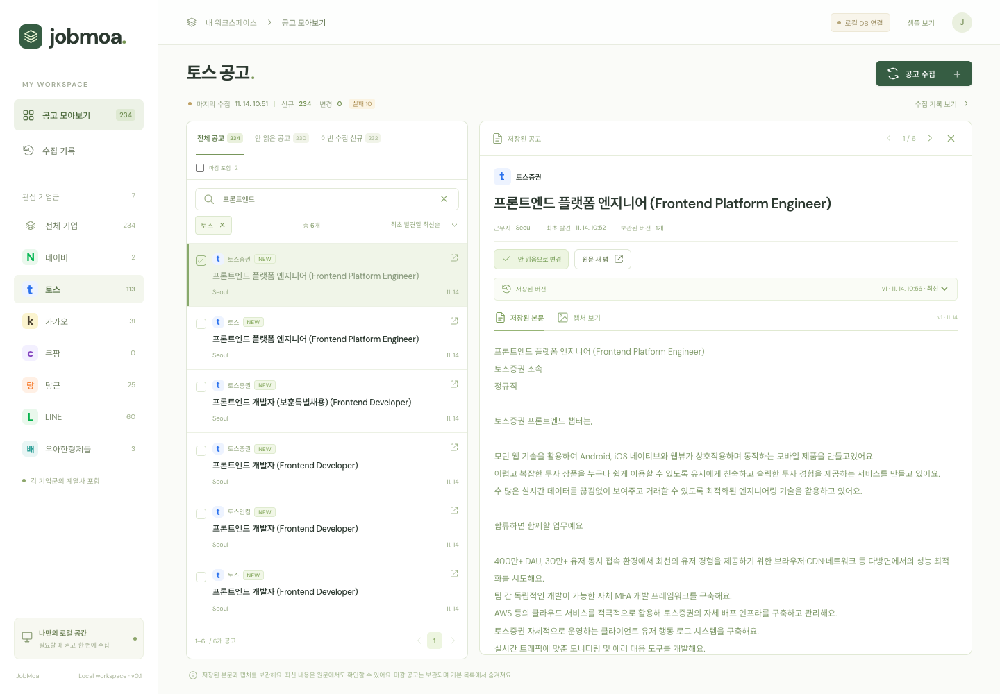
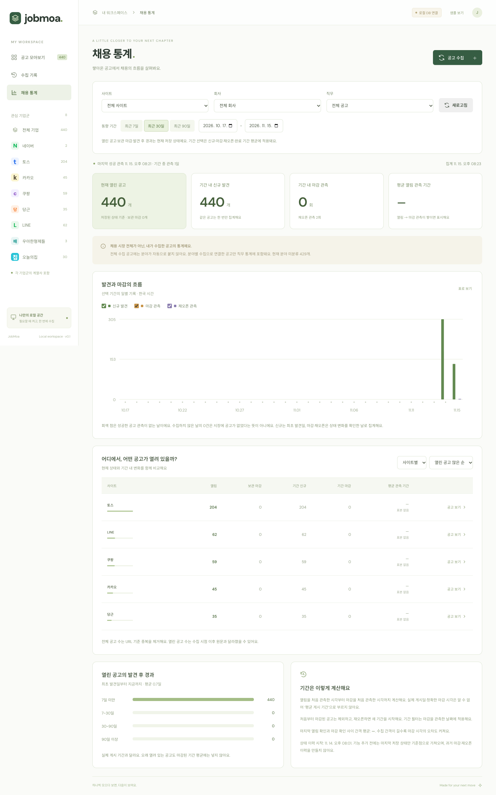
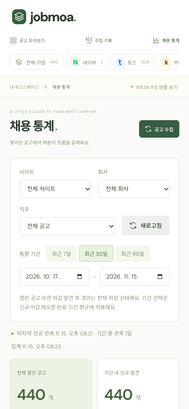

# JobMoa

**여러 회사와 직무의 채용공고를 한곳에 모으고, 수집 시점의 본문과 화면을 함께 보관하는 개인용 로컬 도구입니다.**

네이버·토스·카카오·쿠팡·당근·LINE·우아한형제들 및 연결된 계열사와 오늘의집 공식 채용 사이트를 선택해 수집합니다. 관심 공고를 검색하고 읽음으로 관리하며, 내용이 바뀌면 이전 버전도 다시 확인할 수 있습니다.


> 첫 화면은 2026-11-21 로컬 API 화면을 촬영했습니다. 공고 내용과 건수는 촬영 당시의 값이며 현재 데이터 수를 나타내지 않습니다. 아래의 일부 스크린샷은 이전 화면 구성입니다.

## 주요 기능

### 1. 직무와 기업군·계열사를 골라 수집

`공고 수집`에서 먼저 분야를 고른 뒤, 해당 분야 수집을 지원하는 기업군·계열사를 선택합니다. 회사별 후보·본문 판별 규칙을 통과한 공고의 본문과 캡처를 저장합니다. 지원하지만 현재 공고가 없는 회사는 0건으로 기록합니다.

수집이 공고 본문 저장까지 끝나면 지원서 페이지 확인 이력이 없는 열린 공고와 내용이 변경된 공고의 공개 지원 링크도 자동 확인 대기열에 등록합니다. 동일 공고를 매번 다시 방문하지 않으며, 실패 건은 공고 상세에서 재시도할 수 있습니다. 최초 실행은 기존 미확인 공고가 많이 포함될 수 있으니 회사·직군 범위를 선택해 수집하세요. 지원 페이지 확인과 AI 분석은 수집 기록의 완료 건수와 별도로 비동기 처리됩니다.

개발 분야는 웹 백엔드·프론트엔드·Android·iOS·풀스택·데이터 엔지니어·ML 엔지니어·DevOps/SRE입니다. 비개발은 오늘의집·토스 계열사·당근·당근페이의 기획·PM·디자인·마케팅·영업을 지원합니다. 회사마다 지원하는 분야가 다르며, 실제 선택 가능한 조합은 수집 창에서 확인합니다.


- 분야 선택 후 기업군 전체 선택·해제 또는 계열사별 선택
- 전체 조회와 분야별 조회, 동일 공고의 여러 분야 연결
- 사용자가 버튼을 누를 때 수집 실행
- 일부 포털이나 공고가 실패해도 성공한 결과는 보관



### 2. 공고 목록부터 빠르게 훑기

공고 모아보기 첫 화면은 소개 카드보다 목록을 먼저 보여줍니다. 최근 수집 시각과 신규·관심 공고 변경·마감·실패 건수는 한 줄 요약으로 확인하며, 숫자를 누르면 해당 공고 목록이나 수집 기록으로 이동합니다. 직군 선택은 그룹별 검색 팝오버로 제공하고, 현재 선택과 건수를 버튼에 표시합니다. 회사·공고명·근무지 검색도 목록 바로 위에 둡니다.

- 전체 공고 / 안 읽은 공고 / 이번 수집 신규 탭
- 최초 발견일 최신순·오래된순, 회사 이름순 정렬
- 읽음 체크와 마감 공고 포함 옵션
- 관심 공고 등록과 메모·우선순위·지원 여부·지원일 관리
- 재수집해도 최초 발견일을 유지해 목록 순서 보존


### 3. 목록을 유지하며 저장된 본문 읽기

공고를 열면 기존 표 위에 오른쪽 상세 패널이 겹쳐 열립니다. 검색·정렬·페이지와 표 위치를 유지한 채 이전·다음 버튼으로 연속해서 읽고, 원문은 새 탭에서 열 수 있습니다.

- 열람 시 자동 읽음 처리, 필요하면 안 읽음으로 되돌리기
- 안 읽은 공고를 탐색하는 중에도 처음 선택한 목록 순서 유지
- 브라우저 뒤로·앞으로로 주요 화면과 상세·수집 기록을 오가며 목록 조건과 위치 복원
- 상세 화면에서 최초 발견일과 보관된 버전 확인
- 변경된 공고는 새 버전을 저장하고, 같은 내용은 버전 중복 생성 없이 확인 결과만 기록



### 4. 수집 당시의 원문 화면 보관

`캡처 보기`를 누르면 수집 시점에 저장한 실제 채용 페이지 이미지가 표시됩니다. 이미지는 확대해서 볼 수 있으며, 본문과 캡처 모두 저장된 버전을 선택해 확인합니다. 캡처는 해당 탭을 열 때 불러옵니다.


마감된 공고도 보관하며 기본 목록에서는 숨깁니다. 일시적인 조회 실패나 목록 누락만으로 마감 처리하지 않습니다.

### 5. 수집 결과를 확인하고 실패한 항목만 재시도

실행마다 수집 시각·소요 시간·진행률과 기업군별 성공·신규·변경·동일·실패 결과를 확인할 수 있습니다. 목록을 확인하지 못한 집계는 `—`로 표시해 실제 `0건`과 구분합니다.


실패 항목을 펼치면 대상 URL, 실패 단계·시각, 재시도 횟수, 오류 원문이 표시됩니다. 실패 전체 또는 개별 항목을 선택해 해당 단계부터 다시 실행할 수 있습니다. 캡처 단계에서 실패했다면 저장된 본문은 유지합니다.


재시도는 원 실행과 연결된 별도 기록으로 남고, 성공하면 원 실패 기록에 복구 여부가 표시됩니다.

### 6. 좁은 화면에서도 공고 확인

모바일 너비에서는 기업군 메뉴가 상단으로 이동합니다. 목록은 가로로 스크롤할 수 있고, 공고 본문도 좁은 화면에 맞춰 확인할 수 있습니다.

<p>
  
  
</p>

### 7. 채용 통계로 흐름 확인

`채용 통계`에서 사이트·회사·개발 세부 직무·비개발 직무·기간을 골라 현재 열린 공고와 신규·마감·재오픈 관측을 비교합니다. 그래프를 표로 바꾸고, 비교 행에서 해당 공고 목록으로 바로 이동할 수 있습니다.

평균은 열림부터 마감까지 **관측한 기간**입니다. 실제 게시 기간과 구분하고, 아직 열린 공고는 평균에 섞지 않습니다. 표본이 쌓이기 전에는 `—`로 표시합니다. 수집하지 않은 기간과 미분류 공고도 드러냅니다. [통계 기준과 API](docs/statistics.md)에서 계산 방식과 한계를 확인할 수 있습니다.





### 8. 저장 공고에 AI로 질문

`AI에게 질문`에서 공고 상세를 하나씩 열지 않고 모든 저장 공고를 두고 질문할 수 있습니다. 대화는 저장되고 답변은 작업 ID를 받아 비동기로 처리합니다. 문장 단위 진행 상황과 외부 웹 검색 상태를 실시간으로 확인하며, 브라우저를 닫았다 다시 열어도 저장된 답변부터 이어집니다. 답변의 Markdown 강조는 굵게 렌더링하고 본문 속 공고 인용을 누르면 해당 공고를 엽니다. 완료 시 공고와 외부 웹 출처를 나눠 표시합니다.

`./start.sh`가 Docker 앱을 시작한 뒤 Codex 워커도 자동으로 시작합니다. Java 21 이상, Codex CLI 설치 및 로그인(`codex login`)이 필요하며, 준비되지 않았으면 공고 기능은 실행되고 AI 질문·경력 자료 분석은 워커가 연결될 때까지 대기합니다. 워커만 다시 시작하려면 `./ai-worker.sh start`를 실행합니다. 모델은 `gpt-6-luna`로 고정하며, AI는 공고 상태를 바꾸지 않습니다. [AI 질문 상세](docs/ai-chat.md).

### 경력 자료 등록

`경력 자료` 메뉴에서 이력서·포트폴리오·프로젝트 문서 등을 형식 구분 없이 여러 개 올립니다. 파일 형식을 자동 판별하고 읽을 수 있는 본문은 위치 정보와 함께 저장합니다. AI가 찾은 경력·프로젝트·기술 후보는 원문 근거를 같이 보여주며 `확인 전`으로 보관합니다. 원본 파일은 로컬 디스크에 남고, AI 분석을 위해 추출 텍스트와 파일명을 Codex 서비스로 전송합니다. Codex 워커가 꺼져 있을 때도 파일 등록은 가능하며 분석은 대기합니다. 파일당 50 MiB, 한 번에 20개·200 MiB 제한이 있습니다.

### 공고별 지원서 문항 정리

공고 수집 뒤 지원서 페이지 확인 이력이 없는 열린 공고와 내용이 바뀐 공고는 공개 지원 문항을 자동 확인합니다. 기존 이력이 있는 동일 공고는 반복 확인하지 않습니다. 공고 상세에서는 저장된 본문 분석, 공개 지원 페이지 재확인, 빈 문항·제출 안내 붙여넣기를 할 수 있습니다. 자동 확인은 공개 지원 링크만 열고 페이지 텍스트를 읽습니다. 로그인·쿠키·폼 입력·지원 제출은 하지 않으며, 로그인 후 문항은 직접 복사해야 합니다. AI는 제출 서류, 질문 원문, 필수 여부와 글자 수 등을 근거와 함께 초안으로 저장합니다. 원문·분석 이력은 공고별로 남고, 확인 뒤 `확인 완료`를 누르면 확정됩니다. 분석을 요청하면 원문이 Codex 서비스로 전달되므로 비밀번호·개인정보·작성한 답변은 넣지 마세요. [제품 범위](docs/spec.md#공고별-지원서-요구-정보).

## 빠른 시작

Docker Desktop을 실행한 뒤 프로젝트 루트에서 시작합니다.

```sh
./start.sh
```

| 서비스 | 접속 주소 |
| --- | --- |
| 웹 화면 | [http://127.0.0.1:15173](http://127.0.0.1:15173) |
| 백엔드 API | [http://127.0.0.1:18080](http://127.0.0.1:18080) |
| 백엔드 상태 | [http://127.0.0.1:18080/actuator/health](http://127.0.0.1:18080/actuator/health) |
| MySQL | `127.0.0.1:13306` |

1. 웹 화면에서 `공고 수집`을 누르고 분야 → 지원 기업군·계열사를 선택합니다.
2. 수집 중 진행 상황과 완료 결과는 `수집 기록`에서 확인합니다.
3. 공고를 검색해 열고, 저장된 본문·캡처를 확인합니다. `./start.sh`는 전체 스택과 Codex 워커 시작을 함께 시도합니다. 워커가 연결되지 않으면 `./ai-worker.sh status`로 원인을 확인할 수 있습니다.

종료할 때는 다음 명령을 사용합니다.

```sh
./stop.sh
```

`start.sh`는 기존 구성을 내리고 **15173·18080·13306 포트의 컨테이너와 프로세스를 종료한 뒤** 다시 빌드·실행합니다. `stop.sh`도 같은 포트를 정리하며, 정상 종료 후 남은 프로세스는 강제 종료합니다. 다른 프로젝트에서 해당 포트를 사용하고 있다면 실행 전에 확인하세요. 5173·3307은 정리 대상이 아닙니다.

공고·읽음 상태·수집 기록은 MySQL 볼륨에, 캡처는 `backend/storage/captures`에 저장합니다. 일반 시작·종료 시 보존됩니다.

실행 상태와 로그 확인:

```sh
docker compose ps
docker compose logs --tail=80 backend
```

## 수집 범위

| 기업군 | 구현된 주요 포털 |
| --- | --- |
| 네이버 | 통합 채용, 클라우드, SNOW/KREAM, 랩스, 웹툰, 파이낸셜, I&S, Z |
| 토스 | 통합 채용 포털의 계열사별 포지션 |
| 카카오 | 본사, 페이, 뱅크, 페이증권, 모빌리티, 엔터프라이즈, 엔터테인먼트, 스타일, VX, 페이손해보험, 디케이테크인, 키즈노트 |
| 쿠팡 | 그룹 공식 Greenhouse 공개 보드 |
| 당근 | 당근·당근페이 통합, 당근서비스, 일본·북미 포털 |
| LINE | LINE Careers 전 지역, LY 일본, LY Communications |
| 우아한형제들 | 우아한형제들, 우아한청년들 |
| 오늘의집 | 버킷플레이스 공식 채용 사이트 · 개발 및 초기 비개발 분야 |
| 쏘카 | 공식 채용 목록의 개발/데이터 분류 · 쏘카·나인투원 |
| 컬리 | Greeting 채용 목록 · 테크 분야 |
| 무신사 | 공식 무신사 채용 · 무신사·29CM 등 6개 게시 회사 |
| 야놀자 | Workday 공개 구인 API |
| 리디 | RoundHR 공개 채용 API · 제품/개발 분야 |
| 채널코퍼레이션 | 채널톡 공개 채용 페이지 · 소프트웨어 Engineering 역할 |
| 여기어때 | 공식 Greeting 채용 페이지 · 기술 직군의 개발 공고 후보 |
| 뱅크샐러드 | 공식 채용 목록에서 Greeting 상세 링크 사용 |
| 직방 | Greeting 공개 채용 홈 · Engineering 후보 |

등록된 공개 포털을 기준으로 수집하며, 전 세계 모든 법인의 채용 사이트를 포함한다는 의미는 아닙니다. 실행 중인 서버의 최신 등록 목록은 [`/api/sources`](http://127.0.0.1:18080/api/sources)의 `portals`에서 확인할 수 있습니다.

채용 사이트의 구조 변경·접근 제한에 따라 수집이 실패할 수 있습니다. 쿠팡·여기어때 등은 403이나 보안 확인 화면이 나면 이를 공고로 저장하지 않습니다. 새 9개 어댑터는 코드에 등록됐지만 수집 버튼을 통한 검증을 수행하지 않았습니다. 실패 원인은 수집 기록에 남습니다.

## 기술 구성

| 영역 | 기술 |
| --- | --- |
| 프론트엔드 | React 19, TypeScript, Vite |
| 백엔드 | Kotlin, Spring Boot, Spring Data JPA |
| 데이터베이스 | MySQL 8.4, Flyway |
| 브라우저 수집 | Playwright, Chromium |
| 로컬 실행 | Docker Compose, Nginx |

```text
분야·계열사 선택 → 포털별 후보 탐색 → MySQL 작업 큐
                                    ↓
                             본문 추출·직무 판별 → 변경 비교 → 캡처·저장
                                    ↓
                          공고·변경 버전·수집 결과 조회
```

- 포털별 목록 탐색을 독립 작업으로 저장하고, 공고는 공통 큐에서 처리합니다.
- 기본 작업자 3개, 사이트별 활성 페이지 작업 1개로 실행합니다. `CRAWLER_WORKERS`, `CRAWLER_SITE_CONCURRENCY`로 조정할 수 있습니다.
- 브라우저 탐색과 캡처는 DB 트랜잭션 밖에서 수행하고, 단계별 체크포인트를 저장합니다.
- 임대 토큰과 갱신으로 작업 소유권을 관리하며, 중단된 공고 작업은 임대 만료 후 체크포인트부터 이어서 처리합니다.
- 목록·진행률 응답에서 본문을 분리하고, 상세 본문과 캡처는 필요할 때 조회합니다.
- 같은 공고를 다른 분야에서 수집해도 원본은 공유합니다. 본문이 같으면 캡처·버전 저장을 생략하고 전체 직군 규칙의 결과로 연결을 갱신합니다.

## 로컬 개발

### 프론트엔드

Node.js 22.18 이상이 필요합니다. Docker 프론트와 개발 서버는 같은 포트를 사용하므로, 프론트 컨테이너만 멈추고 DB·백엔드를 유지합니다.

```sh
# 프로젝트 루트
docker compose stop frontend
docker compose up --build -d --wait backend
cd frontend
npm ci
npm run dev
```

개발 서버는 [http://127.0.0.1:15173](http://127.0.0.1:15173)에서 실행하고 `/api`를 백엔드의 18080 포트로 연결합니다. 15173 포트가 사용 중이면 다른 포트로 변경하지 않고 종료합니다.

```sh
npm run build
npm run lint
```

### 백엔드

Java 21 이상과 Chrome이 필요합니다. DB만 Docker로 실행하고 백엔드를 로컬에서 구동할 수 있습니다.

```sh
# 프로젝트 루트
docker compose stop backend frontend
docker compose up -d --wait mysql
cd backend
BROWSER_CHANNEL=chrome ./gradlew bootRun
```

환경변수·API·수집기 구조는 [백엔드 안내](backend/README.md)에서 확인할 수 있습니다.

### 샘플 화면

[http://127.0.0.1:15173/?demo=1](http://127.0.0.1:15173/?demo=1)에서 샘플 공고·변경 버전·실패·재시도 흐름을 살펴볼 수 있습니다. 샘플 수집은 실제 사이트에 접속하지 않는 시뮬레이션이며, 캡처도 예시 SVG입니다. 샘플 상태는 별도 localStorage 키 `jobmoa.frontend-preview.v1`에 저장됩니다.

기본 화면은 실제 API와 MySQL을 사용합니다. 연결 실패 시 오류를 표시하며 샘플 데이터로 자동 전환하지 않습니다.

## 프로젝트 구조

```text
JobMoa/
├── frontend/           # React 화면과 API 연결
├── backend/            # Kotlin API, 수집기, 작업 큐와 저장소
├── docs/
│   ├── README.md       # 문서 역할·변경 영향표·새 문서 기준
│   ├── images/         # README 기능별 화면 캡처
│   └── spec.md         # 현재 제품 스펙
├── scripts/            # 로컬 포트 정리
├── compose.yaml        # MySQL·백엔드·프론트 실행 구성
├── start.sh
└── stop.sh
```

[프론트엔드 안내](frontend/README.md) · [백엔드·API 안내](backend/README.md) · [제품 스펙](docs/spec.md) · [직무 분류 기준](docs/job-categories.md)

문서 역할·변경 영향표·새 문서 작성 기준은 [문서 안내](docs/README.md)를 참고합니다.

제품 적용: [직군 분류 개선안](docs/classification-proposal.md) · [공고별 고정 검토표](docs/analysis/classification-440-2026-11-15.md). 전체 수집을 포함해 21개 직군을 자동 판정하고 복수 매핑·미분류 탭을 지원합니다. 2026-11-15 구현 검증 후 기존 운영 데이터는 사용자 요청으로 초기화했습니다. 현재 공고 수는 실행 중인 화면/API를 기준으로 확인합니다.

분류 규칙 검토: [신규 공고에도 적용할 일반 판정 규칙](docs/classification-rules.md) · [고정 정답셋 440개와의 비교 평가](docs/analysis/classification-evaluation-v0.5.md). 기존 AI 검토 라벨을 고정한 채 별도 규칙의 누락·오분류를 평가합니다. 오프라인 평가 도구는 제품 코드나 DB를 변경하지 않습니다.


## 문서 갱신

기능을 구현하거나 수정할 때 관련 스펙·API·사용법·지원 범위를 함께 갱신합니다. [문서 안내](docs/README.md)에서 문서별 기준 역할·변경 영향표·새 문서 작성 기준을 확인하고, 저장소 작업 규칙은 [AGENTS.md](AGENTS.md)에 따릅니다. 수집기 구현 여부와 실제 표본 검증 범위는 각 수집기 문서에서 구분합니다.

직군별 조회는 목록의 세부 직군 선택을 사용합니다. AI 응용·ML 플랫폼·인프라·DBA·임베디드·로보틱스·QA·데이터 분석까지 구분하고, 한 공고가 여러 직군에 속할 수 있습니다. 미분류 탭에서 근거가 부족한 공고를 확인할 수 있습니다. 새 8직군은 전체 공고 수집 후 자동 분류로 확인하며, 분야별 수집 회사가 아직 등록되지 않았습니다. 저장 본문만 재분류하려면 `curl -X POST http://localhost:18080/api/classifications/rebuild`를 실행합니다. 외부 사이트를 다시 수집하거나 캡처하지 않습니다.

관심 있는 공고는 목록·상세의 ☆를 눌러 ‘관심 공고’ 메뉴에 모을 수 있습니다. 기본 지원 전 탭에서 우선순위 순으로 확인하고, 메모·우선순위·지원 상태·지원일을 편집한 뒤 저장하세요. 지원 완료 탭으로 지원한 공고를 따로 볼 수 있습니다. 관심 해제 후에도 저장한 관리 정보는 남아 재등록하면 다시 표시됩니다. 읽음·마감·재수집과 독립적으로 유지됩니다. [상세 스펙](docs/interest-postings-spec.md).

## 내 데이터 관리와 공고 검토

- **마이페이지**에서 데이터 건수·캡처 용량, 데이터별 초기화, ZIP 백업·복원을 관리한다. 관심 정보, 전체 수집 공고, 읽음 상태, 프리셋을 각각 초기화할 수 있다. 전체 수집 공고 초기화는 관심 정보·본문·캡처·수집 기록·통계도 삭제하고 프리셋은 유지한다.
- **공고 상세 → 변경점 비교**에서 저장된 버전을 문장 단위 diff로 확인한다. 추가는 초록색 `+`, 삭제는 붉은색 `−`다.
- **공고 수집 → 기업 선택**에서 직군·회사 조합을 프리셋으로 저장한다. ‘함께 수집할 직군’으로 여러 직군을 선택할 수 있으며, 수집 창 첫 단계의 프리셋 `바로 수집`으로 실행한다.
- **마지막 수집 / 수집 기록**의 변화 요약 숫자를 누르면 해당 실행에서 새로 발견·변경·마감된 공고만 모아서 본다. 관심 공고의 변화는 수집 당시 관심 표시를 기준으로 저장한다.
- **관심 공고**에서 후보 2~3개의 `비교`를 선택하면 회사·근무지·메모·본문을 나란히 볼 수 있다.

백업은 ZIP 다운로드 후 다른 PC의 같은 스키마 버전에서 복원할 수 있다. 공고 데이터와 캡처, 공고별 지원서 정보, 경력 자료 원본·추출 내용도 포함한다. 복원은 현재 전체 데이터 교체이므로 먼저 현재 백업을 받아둔다. 파일 선택 후 검증된 건수 미리보기를 확인하고 `복원`을 입력해야 적용한다. 초기화는 `초기화`를 입력한다. 수집 중에는 백업·초기화·복원을 차단한다. 상세 범위·크기 제한·저장 방식은 [개인 데이터 관리와 공고 검토 도구](docs/workspace-tools-spec.md)를 참고한다.

## 마감된 공고의 재확인

수집할 때 기존에 보관한 미마감 공고도 선택한 회사·직군 범위에서 다시 확인한다. 본문이 없어져도 사이트별 종료 안내를 확인하면 공고를 마감 처리하고, 마지막 정상 본문·캡처와 메모·지원 기록은 유지한다. 오류 화면을 공고 캡처로 덮어쓰지 않는다. 수집 기록의 ‘마감 확인’에서 건수를 보고, 변화 요약의 ‘새로 마감’에서 상태가 바뀐 공고를 모아서 볼 수 있다. 단순 404·접근 차단·429는 일괄 마감 처리하지 않는다. [사이트별 기준과 실제 확인 범위](docs/closure-detection.md)를 참고한다.
