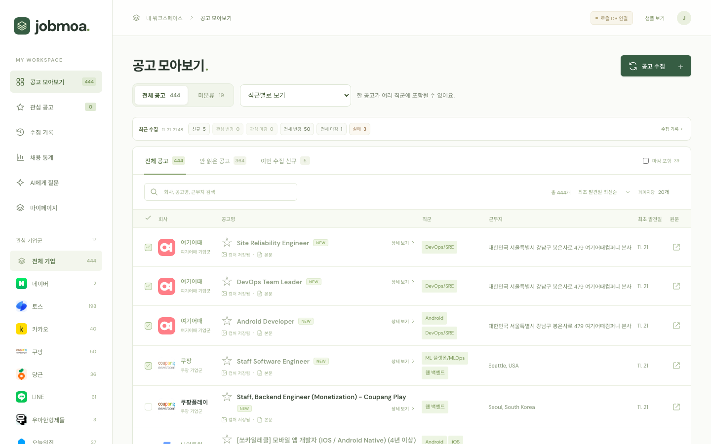
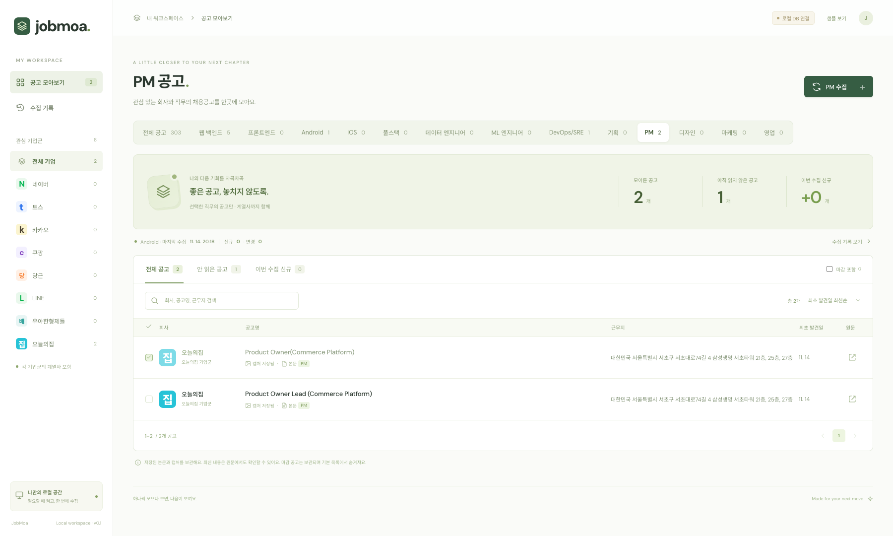
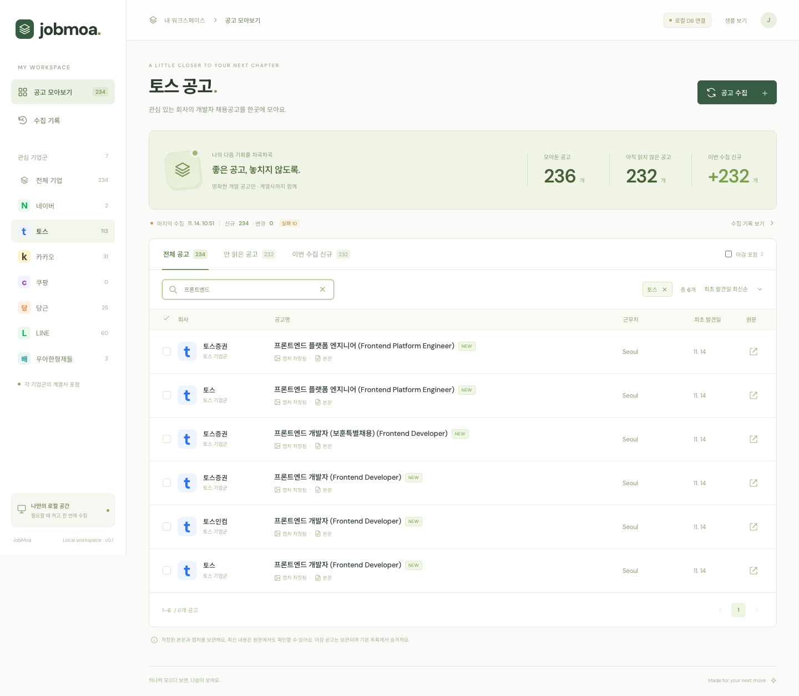
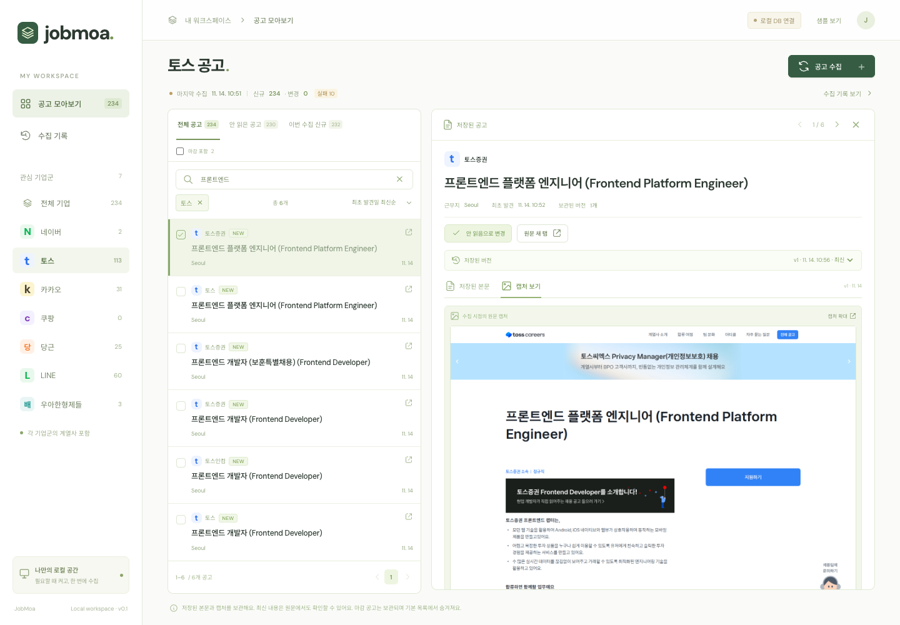
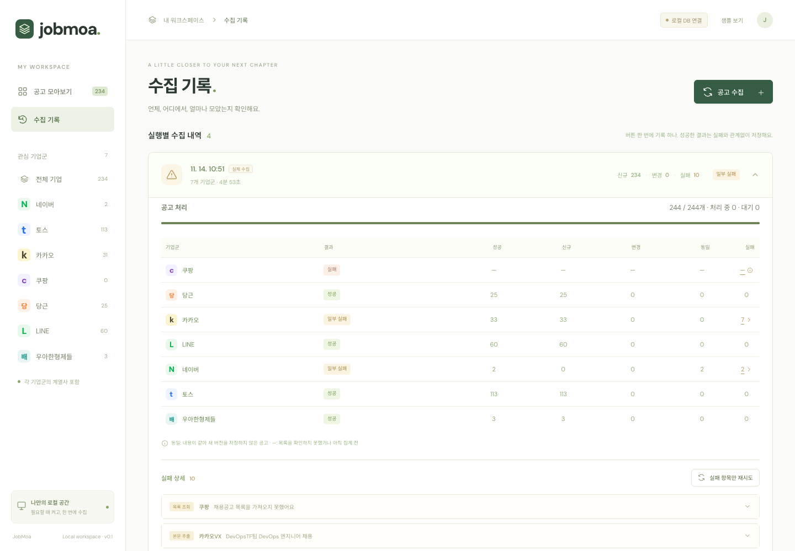
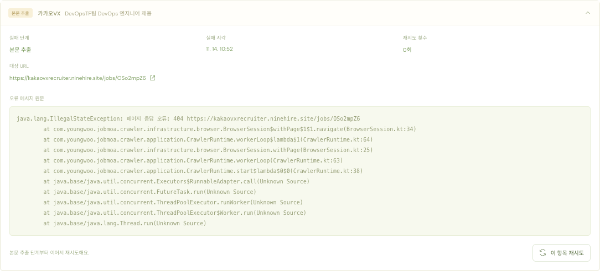
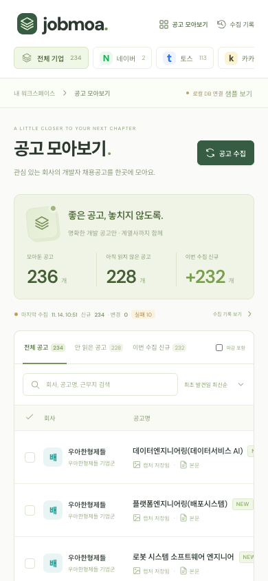
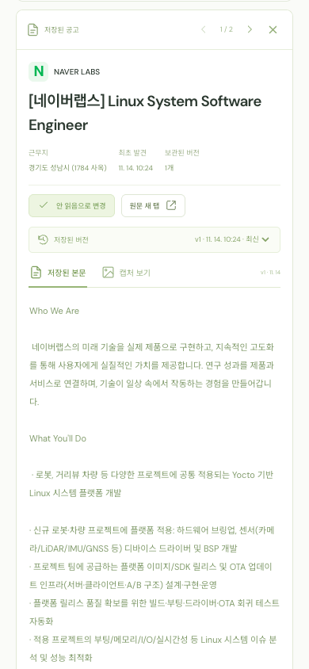

# JobMoa

**여러 회사와 직무의 채용공고를 한곳에 모으고, 수집 시점의 본문과 화면을 함께 보관하는 개인용 로컬 도구입니다.**

네이버·토스·카카오·쿠팡·당근·LINE·우아한형제들 및 연결된 계열사와 오늘의집 공식 채용 사이트를 선택해 수집합니다. 관심 공고를 검색하고 읽음으로 관리하며, 내용이 바뀌면 이전 버전도 다시 확인할 수 있습니다.



> 아래 화면은 로컬 실제 API·MySQL에 연결해 촬영한 예시입니다. 일부 이미지는 이전 화면 구성이며, 직무별 수집을 포함한 현재 동작은 이 문서와 수집 창을 기준으로 확인합니다. 공고와 수집 결과는 촬영 당시의 데이터입니다.

## 주요 기능

### 1. 직무와 기업군·계열사를 골라 수집

`공고 수집`에서 먼저 분야를 고른 뒤, 해당 분야 수집을 지원하는 기업군·계열사를 선택합니다. 회사별 후보·본문 판별 규칙을 통과한 공고의 본문과 캡처를 저장합니다. 지원하지만 현재 공고가 없는 회사는 0건으로 기록합니다.

개발 분야는 웹 백엔드·프론트엔드·Android·iOS·풀스택·데이터 엔지니어·ML 엔지니어·DevOps/SRE입니다. 비개발은 오늘의집의 기획·PM·디자인·마케팅·영업부터 지원합니다. 회사마다 지원하는 분야가 다르며, 실제 선택 가능한 조합은 수집 창에서 확인합니다.



- 분야 선택 후 기업군 전체 선택·해제 또는 계열사별 선택
- 전체 조회와 분야별 조회, 동일 공고의 여러 분야 연결
- 사용자가 버튼을 누를 때 수집 실행
- 일부 포털이나 공고가 실패해도 성공한 결과는 보관


### 2. 검색과 필터로 관심 공고 탐색

기업군을 선택한 상태에서 회사·공고명·근무지를 검색할 수 있습니다. 아래는 토스 기업군에서 `프론트엔드`를 검색한 결과입니다.

- 전체 공고 / 안 읽은 공고 / 이번 수집 신규 탭
- 최초 발견일 최신순·오래된순, 회사 이름순 정렬
- 읽음 체크와 마감 공고 포함 옵션
- 재수집해도 최초 발견일을 유지해 목록 순서 보존



### 3. 목록 옆에서 저장된 본문 읽기

공고를 열면 왼쪽에 탐색 목록, 오른쪽에 저장된 본문이 나타납니다. 이전·다음 버튼으로 연속해서 읽고, 원문은 새 탭에서 열 수 있습니다.

- 열람 시 자동 읽음 처리, 필요하면 안 읽음으로 되돌리기
- 안 읽은 공고를 탐색하는 중에도 처음 선택한 목록 순서 유지
- 상세 화면에서 최초 발견일과 보관된 버전 확인
- 변경된 공고는 새 버전을 저장하고, 같은 내용은 버전 중복 생성 없이 확인 결과만 기록


### 4. 수집 당시의 원문 화면 보관

`캡처 보기`를 누르면 수집 시점에 저장한 실제 채용 페이지 이미지가 표시됩니다. 이미지는 확대해서 볼 수 있으며, 본문과 캡처 모두 저장된 버전을 선택해 확인합니다. 캡처는 해당 탭을 열 때 불러옵니다.



마감된 공고도 보관하며 기본 목록에서는 숨깁니다. 일시적인 조회 실패나 목록 누락만으로 마감 처리하지 않습니다.

### 5. 수집 결과를 확인하고 실패한 항목만 재시도

실행마다 수집 시각·소요 시간·진행률과 기업군별 성공·신규·변경·동일·실패 결과를 확인할 수 있습니다. 목록을 확인하지 못한 집계는 `—`로 표시해 실제 `0건`과 구분합니다.



실패 항목을 펼치면 대상 URL, 실패 단계·시각, 재시도 횟수, 오류 원문이 표시됩니다. 실패 전체 또는 개별 항목을 선택해 해당 단계부터 다시 실행할 수 있습니다. 캡처 단계에서 실패했다면 저장된 본문은 유지합니다.



재시도는 원 실행과 연결된 별도 기록으로 남고, 성공하면 원 실패 기록에 복구 여부가 표시됩니다.

### 6. 좁은 화면에서도 공고 확인

모바일 너비에서는 기업군 메뉴가 상단으로 이동합니다. 목록은 가로로 스크롤할 수 있고, 공고 본문도 좁은 화면에 맞춰 확인할 수 있습니다.

<p>
  
  
</p>

## 빠른 시작

Docker Desktop을 실행한 뒤 프로젝트 루트에서 시작합니다.

```sh
./start.sh
```

| 서비스 | 접속 주소 |
| --- | --- |
| 웹 화면 | [http://127.0.0.1:15173](http://127.0.0.1:15173) |
| 백엔드 API | [http://127.0.0.1:18080](http://127.0.0.1:18080) |
| 백엔드 상태 | [http://127.0.0.1:18080/actuator/health](http://127.0.0.1:18080/actuator/health) |
| MySQL | `127.0.0.1:13306` |

1. 웹 화면에서 `공고 수집`을 누르고 분야 → 지원 기업군·계열사를 선택합니다.
2. 수집 중 진행 상황과 완료 결과는 `수집 기록`에서 확인합니다.
3. 공고를 검색해 열고, 저장된 본문·캡처를 확인합니다.

종료할 때는 다음 명령을 사용합니다.

```sh
./stop.sh
```

`start.sh`는 기존 구성을 내리고 **15173·18080·13306 포트의 컨테이너와 프로세스를 종료한 뒤** 다시 빌드·실행합니다. `stop.sh`도 같은 포트를 정리하며, 정상 종료 후 남은 프로세스는 강제 종료합니다. 다른 프로젝트에서 해당 포트를 사용하고 있다면 실행 전에 확인하세요. 5173·3307은 정리 대상이 아닙니다.

공고·읽음 상태·수집 기록은 MySQL 볼륨에, 캡처는 `backend/storage/captures`에 저장합니다. 일반 시작·종료 시 보존됩니다.

실행 상태와 로그 확인:

```sh
docker compose ps
docker compose logs --tail=80 backend
```

## 수집 범위

| 기업군 | 구현된 주요 포털 |
| --- | --- |
| 네이버 | 통합 채용, 클라우드, SNOW/KREAM, 랩스, 웹툰, 파이낸셜, I&S, Z |
| 토스 | 통합 채용 포털의 계열사별 포지션 |
| 카카오 | 본사, 페이, 뱅크, 페이증권, 모빌리티, 엔터프라이즈, 엔터테인먼트, 스타일, VX, 페이손해보험, 디케이테크인, 키즈노트 |
| 쿠팡 | 그룹 공식 Greenhouse 공개 보드 |
| 당근 | 당근·당근페이 통합, 당근서비스, 일본·북미 포털 |
| LINE | LINE Careers 전 지역, LY 일본, LY Communications |
| 우아한형제들 | 우아한형제들, 우아한청년들 |
| 오늘의집 | 버킷플레이스 공식 채용 사이트 · 개발 및 초기 비개발 분야 |

등록된 공개 포털을 기준으로 수집하며, 전 세계 모든 법인의 채용 사이트를 포함한다는 의미는 아닙니다. 실행 중인 서버의 최신 등록 목록은 [`/api/sources`](http://127.0.0.1:18080/api/sources)의 `portals`에서 확인할 수 있습니다.

채용 사이트의 구조 변경·접근 제한에 따라 수집이 실패할 수 있습니다. 쿠팡은 원문 HTTP 403이나 보안 확인 화면으로 본문 단계가 실패할 수 있으며, 차단 화면은 공고로 저장하지 않습니다. 실패 원인은 수집 기록에 남습니다.

## 기술 구성

| 영역 | 기술 |
| --- | --- |
| 프론트엔드 | React 19, TypeScript, Vite |
| 백엔드 | Kotlin, Spring Boot, Spring Data JPA |
| 데이터베이스 | MySQL 8.4, Flyway |
| 브라우저 수집 | Playwright, Chromium |
| 로컬 실행 | Docker Compose, Nginx |

```text
분야·계열사 선택 → 포털별 후보 탐색 → MySQL 작업 큐
                                    ↓
                             본문 추출·직무 판별 → 변경 비교 → 캡처·저장
                                    ↓
                          공고·변경 버전·수집 결과 조회
```

- 포털별 목록 탐색을 독립 작업으로 저장하고, 공고는 공통 큐에서 처리합니다.
- 기본 작업자 3개, 사이트별 활성 페이지 작업 1개로 실행합니다. `CRAWLER_WORKERS`, `CRAWLER_SITE_CONCURRENCY`로 조정할 수 있습니다.
- 브라우저 탐색과 캡처는 DB 트랜잭션 밖에서 수행하고, 단계별 체크포인트를 저장합니다.
- 임대 토큰과 갱신으로 작업 소유권을 관리하며, 중단된 공고 작업은 임대 만료 후 체크포인트부터 이어서 처리합니다.
- 목록·진행률 응답에서 본문을 분리하고, 상세 본문과 캡처는 필요할 때 조회합니다.
- 같은 공고를 다른 분야에서 수집해도 원본은 공유합니다. 본문이 같으면 캡처·버전 저장을 생략하고 해당 분야만 연결합니다.

## 로컬 개발

### 프론트엔드

Node.js 22.18 이상이 필요합니다. Docker 프론트와 개발 서버는 같은 포트를 사용하므로, 프론트 컨테이너만 멈추고 DB·백엔드를 유지합니다.

```sh
# 프로젝트 루트
docker compose stop frontend
docker compose up --build -d --wait backend
cd frontend
npm ci
npm run dev
```

개발 서버는 [http://127.0.0.1:15173](http://127.0.0.1:15173)에서 실행하고 `/api`를 백엔드의 18080 포트로 연결합니다. 15173 포트가 사용 중이면 다른 포트로 변경하지 않고 종료합니다.

```sh
npm run build
npm run lint
```

### 백엔드

Java 21 이상과 Chrome이 필요합니다. DB만 Docker로 실행하고 백엔드를 로컬에서 구동할 수 있습니다.

```sh
# 프로젝트 루트
docker compose stop backend frontend
docker compose up -d --wait mysql
cd backend
BROWSER_CHANNEL=chrome ./gradlew bootRun
```

환경변수·API·수집기 구조는 [백엔드 안내](backend/README.md)에서 확인할 수 있습니다.

### 샘플 화면

[http://127.0.0.1:15173/?demo=1](http://127.0.0.1:15173/?demo=1)에서 샘플 공고·변경 버전·실패·재시도 흐름을 살펴볼 수 있습니다. 샘플 수집은 실제 사이트에 접속하지 않는 시뮬레이션이며, 캡처도 예시 SVG입니다. 샘플 상태는 별도 localStorage 키 `jobmoa.frontend-preview.v1`에 저장됩니다.

기본 화면은 실제 API와 MySQL을 사용합니다. 연결 실패 시 오류를 표시하며 샘플 데이터로 자동 전환하지 않습니다.

## 프로젝트 구조

```text
JobMoa/
├── frontend/           # React 화면과 API 연결
├── backend/            # Kotlin API, 수집기, 작업 큐와 저장소
├── docs/
│   ├── images/         # README 기능별 화면 캡처
│   └── spec.md         # 현재 제품 스펙
├── scripts/            # 로컬 포트 정리
├── compose.yaml        # MySQL·백엔드·프론트 실행 구성
├── start.sh
└── stop.sh
```

[프론트엔드 안내](frontend/README.md) · [백엔드·API 안내](backend/README.md) · [제품 스펙](docs/spec.md) · [직무 분류 기준](docs/job-categories.md)


## 문서 갱신

기능을 구현하거나 수정할 때 관련 스펙·API·사용법·지원 범위를 함께 갱신합니다. 저장소 작업 규칙은 [AGENTS.md](AGENTS.md)에 둡니다. 수집기 구현 여부와 실제 표본 검증 범위는 각 수집기 문서에서 구분합니다.
